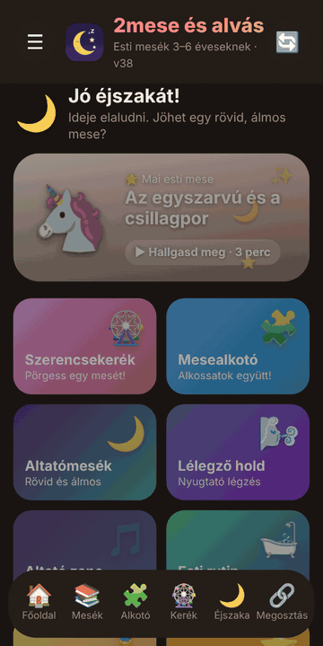
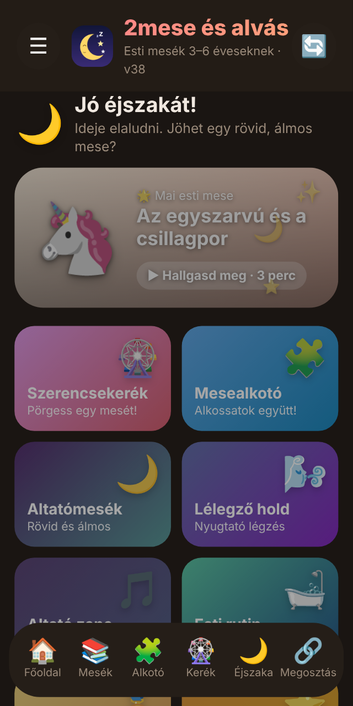
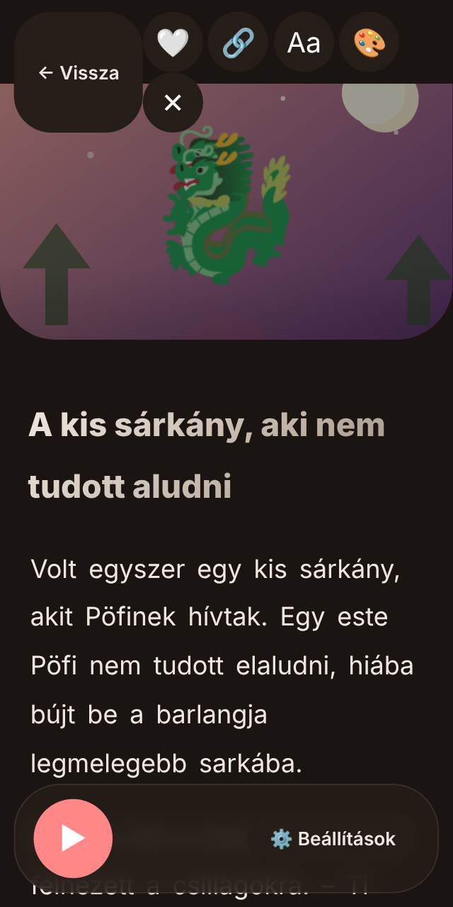

🇬🇧 English · [🇭🇺 Magyar](README.hu.md)

# 2mese és alvás 🌙

A Hungarian bedtime-story app for kids aged 3–6, with read-aloud, lullabies and a calming evening routine. Plain HTML, no build step.



    

> There is no public live URL listed in this repo (it is deployed on Vercel). See "How to run" below to host your own copy in a couple of minutes.

## Features
- About 40 short stories in Hungarian, in categories (bedtime, folk tales, animals, adventure, longer tales)
- Read-aloud with the phone's built-in Hungarian voice (Web Speech API)
- Night mode (switches on automatically in the evening), adjustable text size, favourites
- Evening routine, breathing "moon" exercise, lullaby player, sticker album
- Story creator: combine characters, place and plot cards into a new story, and save your own
- "Wheel of fortune" to pick a random story
- Optional parental lock
- Optional AI illustrations (Hugging Face token needed; falls back to generated SVG covers offline)
- Installable PWA, works offline thanks to a service worker; checks `version.json` and updates itself

## Screenshots
<p> </p>

## How to run locally
```bash
python3 -m http.server 8801
# open http://localhost:8801/index.html
```
To deploy: push to GitHub, then in Vercel choose Add New Project, select the repo, Framework: Other, Deploy.

Adding a story: append a block to `stories.js` (id, title, category, emoji, two colours, paragraphs). When you change anything, bump `v` in `version.json` and the cache name in `sw.js` so installed phones update.

## Tech
Vanilla JavaScript, HTML and CSS; Web Speech API; Service Worker (PWA); no dependencies and no build step.

## Contributing
Contributions are welcome, see [CONTRIBUTING.md](CONTRIBUTING.md). Folk tales are public domain; please do not add modern copyrighted stories.

## License
[MIT](LICENSE) © 2026 strattila90-hue

⭐ If you like it, please give it a star — it really helps!
